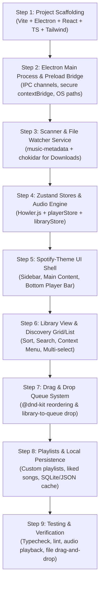

# 🛠️ Tune — Phase 1: MVP Implementation Plan

---

## 🎯 Goal for Phase 1
Build a rock-solid, production-grade MVP of **Tune** that:
1. Launches as a desktop app (Electron + Vite + React + TypeScript + Tailwind CSS).
2. Automatically discovers and scans audio files (`.mp3`, `.mp4`, `.m4a`, `.wav`, `.flac`, `.ogg`) from the user's OS **Downloads folder** in real time (using `chokidar`).
3. Extracts ID3 metadata (title, artist, album, duration, album artwork).
4. Provides full Spotify-style playback controls (play/pause, seek, volume, skip, previous, repeat, shuffle).
5. Provides a side panel with a first-class **Drag & Drop Play Queue** (`@dnd-kit`).
6. Enables creating and managing custom **Playlists**.
7. Supports safe deletion to the OS Recycle Bin (`shell.trashItem()`).

---

## 🏗️ Step-by-Step Execution Plan

---

## 📦 Detailed Breakdown of Steps

### Step 1: Project Scaffolding
- Initialize `package.json` with Electron, Vite, React 18, TypeScript, Tailwind CSS, Lucide icons.
- Configure `tsconfig.json` (renderer and node/main configurations).
- Configure `vite.config.ts` and Tailwind CSS (`tailwind.config.js`, `postcss.config.js`).
- Set up project directory structure strictly adhering to modularity rules (<250 lines per file).

### Step 2: Main Process & IPC Bridge
- `src/main/main.ts`: Electron window lifecycle, secure window configuration (`nodeIntegration: false`, `contextIsolation: true`).
- `src/preload/preload.ts`: Type-safe `contextBridge.exposeInMainWorld('tuneAPI', {...})`.
- `src/types/electron.d.ts`: Full TypeScript declarations for the window API.

### Step 3: File Scanner & Watcher
- `src/main/services/fileScanner.ts`: Scan directories recursively, filter supported formats, extract tags with `music-metadata`.
- `src/main/services/fileWatcher.ts`: `chokidar` listener on `Downloads` folder to stream additions/removals to the UI.
- `src/main/services/fileOps.ts`: Safe delete to Recycle Bin (`shell.trashItem`), show in explorer (`shell.showItemInFolder`).

### Step 4: Audio Engine & State Management
- `src/renderer/audio/audioEngine.ts`: Wrapper around Howler / Web Audio API managing play, pause, seek, volume, end events.
- `src/renderer/store/playerStore.ts`: Playback status, current song, queue, volume, repeat, shuffle.
- `src/renderer/store/libraryStore.ts`: Discovered songs, watched folders, search queries, filter state.
- `src/renderer/store/playlistStore.ts`: User playlists and auto-playlists.

### Step 5: Spotify-Calibre UI Shell
- `Sidebar`: Navigation (Home, Library, Playlists, Liked Songs, Downloads).
- `PlayerBar`: Bottom persistent player (album art, metadata, waveform/seek slider, playback controls, volume, queue toggle).
- `MainContent`: Router/view switcher for Library, Playlist view, and Now Playing.

### Step 6: Library & Song Discovery
- Dual view: **Grid Cards** with album art & **Detailed Table Rows**.
- Sort by date downloaded (newest first), title, artist, duration.
- Real-time search filter.
- Right-click context menu (Play, Add to Queue, Add to Playlist, Delete).

### Step 7: Drag & Drop Queue Panel
- Resizable right side panel for Up Next queue.
- `@dnd-kit/core` + `@dnd-kit/sortable` implementation for smooth reordering.
- Drop targets allowing dragging songs directly from Library into the Queue.

### Step 8: Playlists & Persistence
- Create, rename, delete custom playlists.
- Quick "Heart" button for Liked Songs.
- Persistent local storage for library index and playlist definitions.

---

## 🛡️ Coding Guidelines Applied
- **Strict Modularity**: Each UI component, service, and store separated into small, focused files.
- **Hygiene & Safety**: Zero `any` types; strictly typed IPC channel contracts.
- **Error Boundaries**: Fallback album art and graceful handling for corrupt/unreadable audio files.
