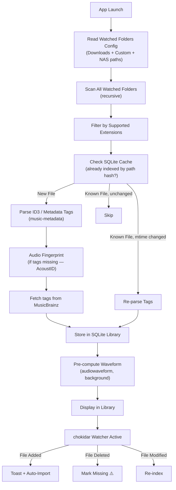
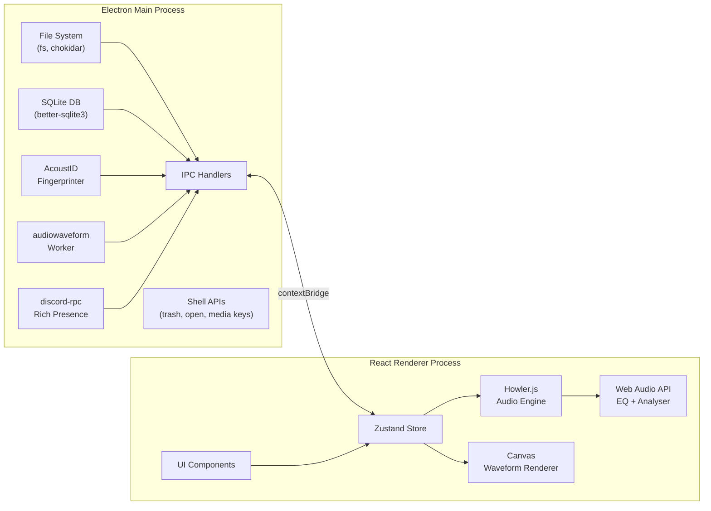
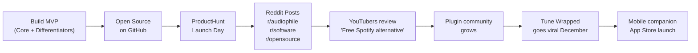
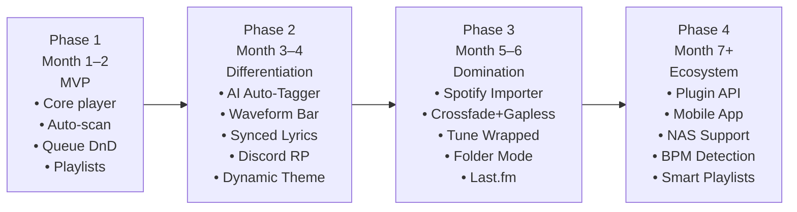

# 🎵 Tune — Offline Music Player
### Complete Product & Technical Documentation v2.0

---

## 💡 Idea Rating

| Dimension | Score | Notes |
|---|---|---|
| **Market Need** | 9/10 | Millions still use local/downloaded music; streaming fatigue is real |
| **Originality** | 8/10 | Local players exist, but none nail the full combo Tune targets |
| **Feasibility** | 9/10 | Fully achievable with modern frameworks |
| **Monetization** | 8/10 | Free core + Pro tier + open-source donations |
| **Scalability** | 9/10 | Plugin ecosystem, mobile app, NAS — roadmap is rich |
| **Overall** | ⭐ 8.6 / 10 | Strong, differentiated, with a clear path to domination |

> [!TIP]
> **Domination formula:** `MusicBee's power + Harmonoid's beauty + everything they're all missing = Tune wins.`
> No paywall on essentials. Open source. Zero accounts. Zero telemetry.

---

## 📋 Table of Contents

1. [App Overview](#1-app-overview)
2. [Target Audience](#2-target-audience)
3. [Tech Stack](#3-tech-stack)
4. [Core Features](#4-core-features)
5. [Advanced Features](#5-advanced-features)
6. [🔥 Killer Differentiators](#6--killer-differentiators-domination-tier)
7. [File Handling & Discovery](#7-file-handling--discovery)
8. [UI/UX Design Specification](#8-uiux-design-specification)
9. [Architecture Overview](#9-architecture-overview)
10. [Data Models](#10-data-models)
11. [Component Breakdown](#11-component-breakdown)
12. [State Management](#12-state-management)
13. [Drag & Drop System](#13-drag--drop-system)
14. [Keyboard Shortcuts](#14-keyboard-shortcuts)
15. [File System & Permissions](#15-file-system--permissions)
16. [Go-to-Market Strategy](#16-go-to-market-strategy)
17. [Monetization](#17-monetization)
18. [Execution Roadmap](#18-execution-roadmap)
19. [Competitor Kill Map](#19-competitor-kill-map)

---

## 1. App Overview

**Tune** is a modern, offline-first desktop music player that automatically discovers MP3/MP4/FLAC files from the user's Downloads folder and any custom directories. It delivers a Spotify-calibre UI with full playback controls, first-class drag-and-drop queue management, AI-powered auto-tagging, synced lyrics, a waveform seek bar, Discord Rich Presence, and an annual "Tune Wrapped" listening report — all completely free, open source, and requiring zero accounts or internet.

| Property | Value |
|---|---|
| **App Name** | Tune |
| **Version** | 2.0 (planned) |
| **Type** | Desktop App (Electron) — PWA as secondary target |
| **Primary Input** | Local `.mp3`, `.mp4`, `.wav`, `.flac`, `.ogg`, `.m4a`, `.aac`, `.opus` |
| **Primary Source** | OS Downloads Folder + User-defined folders + Network Shares |
| **Offline First** | Yes — no internet required for core functionality |
| **Platform** | Windows, macOS, Linux |
| **License** | MIT (Open Source) |
| **Telemetry** | Zero — no analytics, no tracking, ever |

---

## 2. Target Audience

| Segment | Pain Point Tune Solves |
|---|---|
| **Music Collectors** | Library management, auto-tagging, duplicate detection |
| **Audiophiles** | FLAC/WAV support, ReplayGain, audio device selection |
| **Spotify Refugees** | Playlist importer, familiar UI, Wrapped-style reports |
| **DJs & Producers** | Folder mode, BPM detection, long file / DJ set support |
| **Students** | Speed control, bookmarks, long-file chapter support |
| **Gamers / Discord users** | Discord Rich Presence, global hotkeys |
| **NAS / Home Server users** | SMB/network share folder watching |
| **Low-connectivity users** | 100% offline, no cloud dependency |

---

## 3. Tech Stack

### Desktop (Electron + React) — Primary

```
Frontend:    React 18 + TypeScript
Styling:     Tailwind CSS + shadcn/ui
State:       Zustand (slices pattern)
Audio:       Howler.js + Web Audio API (EQ nodes, crossfade, analyser)
File I/O:    Node.js fs + chokidar (file watching)
Database:    SQLite via better-sqlite3 (songs, playlists, history, tags)
Drag & Drop: @dnd-kit/core + @dnd-kit/sortable
Metadata:    music-metadata (ID3 parsing)
Fingerprint: acoustid-fingerprinter + chromaprint
Lyrics:      lrclib-api (free, no account)
Waveform:    audiowaveform (pre-compute) + canvas rendering
Theming:     node-vibrant (album art color extraction)
Discord:     discord-rpc (Rich Presence)
Build:       Vite + electron-builder
Packaging:   electron-builder (NSIS/dmg/AppImage)
```

### PWA (Browser) — Secondary

```
File Access:  File System Access API (showDirectoryPicker)
Storage:      IndexedDB via Dexie.js
Audio:        Web Audio API
Offline:      Service Worker + Cache API
```

> [!NOTE]
> Electron is the primary target — it gives full filesystem access, system tray, global hotkeys, OS media key integration, and Discord IPC without any browser permission friction.

---

## 4. Core Features

### 4.1 File Discovery & Auto-Import
- Scan **Downloads folder** on launch — sorted by date downloaded (newest first)
- **Live file watcher** via `chokidar` — new files appear instantly with a toast
- Support drag-and-drop of files/folders from OS Explorer into the app
- Add unlimited **custom watched folders** in Settings
- **Network share support** — add `\\NAS\Music` or SMB paths as watched folders
- Fallback: scan Music, Desktop folders as optional secondary sources

### 4.2 Playback Controls

| Control | Detail |
|---|---|
| ▶ / ⏸ Play / Pause | Toggle |
| ⏮ Previous | Restart track if >3s played, else go to previous |
| ⏭ Next / Skip | Next in queue |
| ⏩ Forward 10s | Seek +10 seconds |
| ⏪ Backward 10s | Seek −10 seconds |
| 🔁 Repeat | None → Repeat All → Repeat One (cycle) |
| 🔀 Shuffle | True shuffle with no-repeat history |
| 🔊 Volume | Slider + scroll wheel + mute toggle |
| 🌊 Waveform Seek | Click/drag waveform to seek (see §6.3) |
| ⚡ Speed | 0.5x → 2.0x playback speed |

### 4.3 Queue Management
- Full play queue in a resizable side panel
- **Drag and drop** to reorder (insertion-style with drop indicator)
- Add to Queue / Play Next per song
- Clear Queue, Save Queue as Playlist
- Queue persists across app restarts
- Cross-container DnD: Library → Queue, Library → Playlist in sidebar

### 4.4 Library View
- **Grid view** (album art cards) and **List view** (compact rows) toggle
- Sort: Name, Date Added, Date Modified, Duration, Artist, Album, Play Count
- **Search**: real-time filter by title, artist, album, genre, filename
- Right-click context menu: Play, Play Next, Add to Queue, Add to Playlist, Edit Tags, Song Info, Show in Folder, Delete
- Multi-select: `Ctrl+Click`, `Shift+Click`, `Ctrl+A` → batch operations

### 4.5 Delete
- **Soft delete** — hide from library, file stays on disk
- **Hard delete** — `shell.trashItem()` → Recycle Bin / Trash (never `fs.unlink`)
- Confirmation dialog with undo toast (5s grace period)

### 4.6 Custom Playlists
| Action | How |
|---|---|
| Create | Sidebar `+` → name it |
| Add songs | Right-click song → "Add to Playlist" or drag onto sidebar playlist |
| Reorder | Drag & drop within playlist detail view |
| Duplicate / Rename / Delete | Right-click playlist |
| Export | `.m3u` file export |
| Import | Import any `.m3u` from disk |
| Cover Art | Auto (first song's art) or custom image |

**Auto-Playlists (always up-to-date):**
| Name | Logic |
|---|---|
| ❤️ Liked Songs | Heart any song |
| 🕐 Recently Played | Last 50 tracks |
| 🔥 Most Played | Top 25 by play count |

---

## 5. Advanced Features

### 5.1 Smart Queue
- "Up Next" auto-populated based on current song's artist/album/genre
- Queue persists across restarts (saved to SQLite)

### 5.2 Metadata & ID3 Tags
- Auto-read all ID3v2 tags: title, artist, album, year, genre, track number, cover art
- Fallback to filename parsing if no tags
- **Inline tag editor**: double-click any field in Library to edit
- **Batch tag editor**: select multiple songs → set shared fields at once
- Changes written back to the audio file on disk

### 5.3 Sleep Timer
- Presets: 15 / 30 / 45 / 60 min + custom duration
- Fade-out before stop (last 30 seconds)
- System notification 1 minute before

### 5.4 Equalizer
- 10-band EQ via Web Audio API `BiquadFilterNode` chain
- Built-in presets: Flat, Bass Boost, Vocal, Classical, Electronic, Rock, Hip-Hop
- Custom preset: save and name your own

### 5.5 Speed Control
- Playback speed: 0.5x → 2.0x in 0.05x steps
- Pitch-corrected (uses `AudioContext.playbackRate` with tone compensation)
- Useful for lectures, podcasts, DJ rehearsal

### 5.6 Mini Player / PiP Mode
- Compact always-on-top floating pill: album art + title + controls
- True Picture-in-Picture — floats above all other windows
- Click to expand to full app

### 5.7 Themes & Appearance
- **Dark** (default), **Light**, **AMOLED Black**
- **Dynamic theming** — accent color adapts to album art (see §6.7)
- Custom accent color picker (override dynamic theme)
- Font size scale (Accessibility)

### 5.8 File Watcher Notifications
- Toast: *"New song found: Blinding Lights.mp3 — Add to Library?"*
- Toast: *"3 songs are missing from disk"* on startup
- Settings: auto-import without asking, or always ask

### 5.9 Recently Played
- Last 50 tracks with timestamps
- "Continue Listening" on Home screen (resume from last position)

### 5.10 Statistics Dashboard
- Total listening time (all time + this month)
- Most played songs (top 10)
- Most played artists (top 5)
- Genres breakdown (pie chart)
- Listening streaks (days in a row)
- Peak listening hour (heatmap)

### 5.11 Missing File Handling
- Songs whose files moved/deleted → ⚠️ icon in library
- "Relocate File" → browse to find the moved file → path updated in DB
- "Remove All Missing" bulk action
- Startup banner: *"3 songs are missing — click to manage"*

### 5.12 Volume Normalization (ReplayGain)
- Read ReplayGain tags if present, otherwise compute on import
- Apply track gain or album gain
- Toggle on/off + pre-amp slider in Settings

### 5.13 Multi-select & Batch Operations
- `Ctrl+Click` — add to selection
- `Shift+Click` — select range
- `Ctrl+A` — select all visible
- Batch: Add to Queue, Add to Playlist, Edit Tags, Delete, Move to Folder

### 5.14 Album / Artist / Genre Browse Views
- **Albums**: grid of cover art → click → all songs in album
- **Artists**: list → click → all albums by artist
- **Genre**: filter chips → click to show songs of that genre
- Breadcrumb nav: Library → Artist → Album → Song

### 5.15 OS Integration
- **Media Keys** (F7/F8/F9 or dedicated media keys) — play/pause, next, prev
- **Windows SMTC** — song shown on lock screen, taskbar flyout, volume OSD
- **macOS Now Playing** widget
- **System Tray**: app minimizes to tray, right-click for quick controls
- **Taskbar thumbnail controls** (Windows): play/pause, prev, next buttons
- **Headphone Auto-Pause**: pause on 3.5mm unplug or Bluetooth disconnect; resume on reconnect

### 5.16 Audio Output Device Selection
- Dropdown in Settings to choose audio output device
- Useful for DAC, headphone amp, multi-output setups
- Uses `navigator.mediaDevices.enumerateDevices()`

### 5.17 Scroll to Current Song
- "Jump to Now Playing" button in Library toolbar
- Auto-scrolls list/grid to highlight the currently playing track

### 5.18 Song Info Modal
Right-click → Song Info:
- File path, size, format, bitrate, sample rate, duration
- All ID3 tags (editable inline)
- Cover art preview + drag new image to replace
- Play count, date added, last played, file hash

### 5.19 Backup & Restore
- Export: playlists + settings + play history → `.tune-backup` (JSON)
- Import on new device or after reinstall
- Auto-backup schedule (daily/weekly) to a folder of your choice

### 5.20 Long File / Chapter Support
- Smooth seeking through 10+ hour files (DJ sets, audiobooks, lectures)
- Chapter markers from ID3 chapter tags or `.cue` sheets
- Bookmark positions within a file
- Resume from last saved position on reopen

### 5.21 Folder Mode
- File-tree browser alongside the Library view
- Navigate exactly as your folder structure on disk
- Play entire folder / drag folder into queue
- Critical for DJs and producers who organise by project/genre folder

### 5.22 Duplicate Song Detection
- Detect by: audio fingerprint (via AcoustID chromaprint) — not just filename
- Side-by-side comparison: file size, bitrate, format
- Let user pick which copy to keep; other goes to Recycle Bin

### 5.23 Onboarding & Empty States
- Welcome screen on first launch with folder picker
- Animated scan progress bar during initial import
- Beautiful illustrated empty states: Library empty, Playlist empty, No search results
- Tooltip walk-through for queue DnD, playlists, and keyboard shortcuts
- Error state for inaccessible folder with "Retry Scan" button

### 5.24 Global Hotkeys (System-Wide)
- Customisable hotkeys registered at OS level
- Work even when Tune is in the background or minimised
- Example: `Ctrl+Alt+Space` = Play/Pause from anywhere
- Full remapping UI in Settings → Shortcuts

### 5.25 Accessibility (a11y)
- Full keyboard navigation (Tab, Enter, Arrow keys)
- ARIA labels on all interactive elements
- Screen reader tested (NVDA on Windows, VoiceOver on macOS)
- Focus ring always visible
- Font size scaling

---

## 6. 🔥 Killer Differentiators (Domination Tier)

> [!IMPORTANT]
> These are the features no single competitor has all together. Each one alone is a reason to switch. All of them together = **market dominance**.

---

### 6.1 🤖 AI Auto-Tagger (AcoustID + MusicBrainz)
> **The #1 pain point:** Most downloaded files are named `01 - Track 1.mp3` with zero metadata.

- On import, Tune **audio-fingerprints** untagged songs via [AcoustID](https://acoustid.org/) (open API, free)
- Looks up the fingerprint against **MusicBrainz** (world's largest open music database)
- Auto-fills: Title, Artist, Album, Year, Genre, Track Number, Cover Art
- One-click **"Fix All Tags"** button — batch-tags your entire library
- Confidence score shown; user can confirm or reject suggestions
- Works fully **offline after first tag fetch** (cached in SQLite)

```
Before:  "01 - unknown.mp3"      →      After:  "Blinding Lights — The Weeknd (2019) [After Hours]"
```

---

### 6.2 🎵 Synced Lyrics (Privacy-First, No Account)
> **Competitor gap:** Every app that has lyrics requires an account, has telemetry, or paywalls it.

- Fetch from **LRCLib** (free, open, no login)
- Local `.lrc` file auto-detected (drop it next to the song file)
- **Karaoke-style scrolling** lyrics synced word-by-word to playback position
- **Offline cache** — fetched once, works forever without internet
- Full-screen lyrics view with blurred album art background
- Toggle: lyrics always visible in Now Playing bar

---

### 6.3 🌊 Waveform Seek Bar (SoundCloud-Style)
> **Competitor gap:** Every player has a thin flat seek bar. Nobody does a visual waveform.

- Waveform pre-computed on import using `audiowaveform`, cached to disk
- Rendered on a `<canvas>` in the player bar
- Click or drag anywhere on the waveform to seek — far more intuitive
- **Colour-coded**: played = accent colour, unplayed = dim grey
- Hover: timestamp tooltip at cursor position
- **This is the screenshot that goes viral on Reddit/Twitter**

---

### 6.4 📋 Spotify Playlist Importer
> **The biggest Spotify refugee pain point:** *"I left Spotify but can't recreate my playlists with local files."*

- Paste any **public Spotify playlist URL** into Tune
- Tune fetches the track list (title + artist) via Spotify public API
- Scans your local library for matches (fuzzy match on title + artist)
- Results: ✅ Found in library | ❌ Not found (shows what's missing)
- One-click: create a local playlist from all matched songs
- **No Spotify account required** — only reads public playlist data

---

### 6.5 🎙️ Discord Rich Presence
> **Competitor gap:** Zero local music players support this. Streaming apps all do.

- Shows on your Discord profile: *🎵 Listening to Blinding Lights — The Weeknd*
- Displays album art as the large Discord activity image
- Elapsed time shown (how far into the song)
- Toggle on/off per-session in Settings (privacy-conscious)
- **Instant viral appeal** — Discord is used by 500M+ people, mostly the exact audience for Tune

---

### 6.6 📊 "Tune Wrapped" — Annual Listening Report
> **Competitor gap:** Spotify Wrapped is the most-shared content every December. No local player has this.

- Generated on demand (or auto on December 1st)
- **Stats visualised:** Total hours, top 5 songs, top 3 artists, most active day, top genre, listening streak
- Beautiful card UI with dynamic colours from your most-played album art
- **Export as PNG** — ready to share on Instagram, Twitter, WhatsApp
- Goes viral every December — users will share and tag Tune

---

### 6.7 🎨 Dynamic Album Art Theming
> **Competitor gap:** Every player has a static dark theme. Nobody adapts visuals to the music.

- Extract dominant colour palette from album art using `node-vibrant`
- **Smoothly animate** the app's accent colour + background gradient on every song change
- Background: subtle blurred album art with dynamic colour overlay
- Text and button colours auto-adjust for contrast (WCAG AA compliant)
- **Makes every song feel unique** — the most-photographed UI feature

---

### 6.8 📱 WiFi Companion Mobile App (Remote Control)
> **Competitor gap:** MusicBee's #1 complaint is no official mobile app.

- React Native app (iOS + Android)
- **Auto-discovers** Tune desktop on the same WiFi network (mDNS/Bonjour)
- Full remote: play/pause, seek, next, prev, volume, queue reorder
- Browse library and queue songs from your phone
- **Zero internet, zero accounts** — pure local WiFi P2P

---

### 6.9 🧩 Plugin / Extension System
> **Competitor gap:** Only MusicBee has plugins, but it's Windows-only and aging.

- Open JS plugin API — community can extend Tune
- Plugins can add: new UI panels, metadata sources, streaming integrations, visualisers, export formats
- **In-app plugin browser** (install from GitHub URL or local zip)
- Official first-party plugins: Last.fm scrobbler, Tidal bridge, Genius lyrics
- **This creates a community moat** — once plugins exist, users never leave

---

### 6.10 📤 Last.fm Scrobbling (Built-in, Free)
> **Competitor gap:** Requires third-party plugins in every other local player.

- Native Last.fm integration in Settings → connect account
- Every play scrobbled automatically (respects ½-played rule)
- Offline queue: plays while offline are scrobbled when internet returns
- **Last.fm users are fiercely loyal** — this wins them over instantly

---

### 6.11 🔁 Crossfade + Gapless Playback (Free)
> **Competitor gap:** Harmonoid locks crossfade behind its paid Plus tier.

- **Crossfade**: fade out current track while fading in next — slider 0–12 seconds
- **Gapless**: zero gap between tracks (essential for live albums, DJ sets, classical)
- Both features completely free
- **This directly kills Harmonoid Plus's main selling point**

---

### 6.12 🔊 Headphone Auto-Pause
> **Reddit's #1 complaint about ALL music players.**

- Detect audio device disconnect: 3.5mm unplug, Bluetooth drop
- **Instant auto-pause** — no more blasting audio in public
- **Auto-resume** when headphones reconnect
- Configurable: pause only / pause + rewind 2s / do nothing

---

### 6.13 🌍 100% Privacy-First, Zero Telemetry, Open Source
> **Trust moat no competitor has stated explicitly.**

- MIT licence — full source on GitHub
- **Zero analytics, zero crash reporting, zero telemetry** — not even anonymous
- No accounts required for any feature
- Local-only by default; any network feature (Last.fm, AcoustID) is opt-in
- Clear privacy page: *"Tune never sends any data anywhere unless you explicitly enable a feature that requires it."*

---

## 7. File Handling & Discovery

### Supported Formats
| Format | Extension |
|---|---|
| MP3 | `.mp3` |
| MP4 / M4A | `.mp4`, `.m4a` |
| WAV | `.wav` |
| FLAC | `.flac` |
| OGG Vorbis | `.ogg` |
| AAC | `.aac` |
| OPUS | `.opus` |
| AIFF | `.aiff`, `.aif` |
| WMA | `.wma` (via ffmpeg decode) |

### Discovery Flow



### File Sort Order (Downloads Folder)
- Default: **newest first** (by `mtime`)
- Options: Oldest first, A–Z, Z–A, Duration long→short, Duration short→long, Play count

---

## 8. UI/UX Design Specification

### Layout

```
┌──────────────────────────────────────────────────────────────────┐
│  SIDEBAR             │  MAIN CONTENT AREA            │  QUEUE    │
│                      │                               │  PANEL    │
│  🏠 Home             │  [Library / Album / Artist /  │           │
│  📚 Library          │   Playlist / Folder View]     │  Now Up   │
│  💿 Albums           │                               │  ↕ drag   │
│  👤 Artists          │  [Song Grid / List / Tree]    │  ↕ drag   │
│  🎸 Genres           │                               │  ↕ drag   │
│  ➕ Playlists        │                               │           │
│  🕐 Recent           │                               │           │
│  📁 Folders          │                               │           │
│  🔌 Plugins          │                               │           │
│  ⚙  Settings        │                               │           │
│                      │                               │           │
├──────────────────────┴───────────────────────────────┴───────────┤
│                   NOW PLAYING BAR (bottom)                        │
│  [Art] Title - Artist  〰〰〰 WAVEFORM 〰〰〰  ⏮ ⏪ ▶ ⏩ ⏭        │
│  🔀 🔁  🔊────  ⚡1.0x  💬 lyrics  ⏱ timer  ↕ queue  [0:43/3:21] │
└──────────────────────────────────────────────────────────────────┘
```

### Color Palette (Dark Theme — Default)
| Token | Value |
|---|---|
| Background | `#0f0f0f` |
| Surface | `#1a1a1a` |
| Card | `#242424` |
| Accent | Dynamic (from album art) or `#1db954` default |
| Text Primary | `#ffffff` |
| Text Secondary | `#a3a3a3` |
| Border | `#2a2a2a` |
| Waveform Played | Accent colour |
| Waveform Unplayed | `#3a3a3a` |

### Key UI Screens
1. **Home** — Recently played, newly discovered, Continue Listening
2. **Library** — Full song grid/list, search, sort, multi-select
3. **Albums / Artists / Genre** — Browse views with cover art grids
4. **Playlist Detail** — Song list, drag to reorder, playlist actions
5. **Folder Mode** — File-tree browser for power users
6. **Now Playing (Expanded)** — Full-screen: album art, waveform, lyrics, EQ
7. **Tune Wrapped** — Annual listening report with share card
8. **Queue Panel** — Draggable queue list (slide-in from right)
9. **Settings** — Folders, theme, shortcuts, EQ, integrations, plugins
10. **Song Info Modal** — Full metadata + inline editor
11. **Spotify Importer** — Paste URL → match → create playlist

---

## 9. Architecture Overview



### IPC Channels
| Channel | Direction | Description |
|---|---|---|
| `scan-folder` | Main → Renderer | Returns list of audio files |
| `get-metadata` | Main → Renderer | ID3 tags for a file |
| `watch-folder` | Main → Renderer | Start chokidar watcher |
| `file-added` | Main → Renderer | New file detected |
| `file-removed` | Main → Renderer | File deleted |
| `fingerprint-song` | Main → Renderer | AcoustID result |
| `fetch-musicbrainz` | Main → Renderer | Auto-tag result |
| `waveform-ready` | Main → Renderer | Pre-computed waveform data |
| `fetch-lyrics` | Main → Renderer | LRCLib result |
| `discord-update` | Renderer → Main | Update Rich Presence |
| `trash-file` | Renderer → Main | Move to Recycle Bin |
| `open-in-explorer` | Renderer → Main | Open file location |
| `save-playlist` | Renderer → Main | Persist playlist to DB |
| `export-backup` | Renderer → Main | Write `.tune-backup` JSON |
| `global-hotkey` | Main → Renderer | System hotkey triggered |
| `media-key` | Main → Renderer | OS media key pressed |
| `headphone-disconnect` | Main → Renderer | Audio device removed |

---

## 10. Data Models

### Song
```typescript
interface Song {
  id: string;               // SHA-256 of filePath
  filePath: string;
  fileName: string;
  title: string;
  artist: string;
  albumArtist: string;
  album: string;
  genre: string;
  year: number | null;
  trackNumber: number | null;
  discNumber: number | null;
  duration: number;         // seconds
  bitrate: number;          // kbps
  sampleRate: number;       // Hz
  fileSize: number;         // bytes
  format: string;           // 'mp3' | 'flac' | ...
  coverArt: string | null;  // base64 or cached file path
  waveformPath: string | null; // path to .waveform cache file
  lyricsPath: string | null;   // path to .lrc cache
  replayGain: number | null;   // dB offset
  acoustId: string | null;     // AcoustID fingerprint
  dateAdded: Date;
  fileModified: Date;
  playCount: number;
  lastPlayed: Date | null;
  isLiked: boolean;
  isMissing: boolean;
  userRating: number | null; // 1–5 stars
}
```

### Playlist
```typescript
interface Playlist {
  id: string;
  name: string;
  description: string;
  createdAt: Date;
  updatedAt: Date;
  songIds: string[];
  coverArt: string | null;
  isAutoPlaylist: boolean;  // for Liked Songs, Recently Played etc.
  autoPlaylistType: 'liked' | 'recent' | 'mostPlayed' | null;
}
```

### QueueItem
```typescript
interface QueueItem {
  queueId: string;    // unique per slot
  songId: string;
  song: Song;
  position: number;
  addedAt: Date;
  source: 'library' | 'playlist' | 'album' | 'artist' | 'manual';
}
```

### PlayerState
```typescript
interface PlayerState {
  currentSong: Song | null;
  queue: QueueItem[];
  history: QueueItem[];       // played songs for ⏮ navigation
  currentIndex: number;
  isPlaying: boolean;
  volume: number;             // 0–1
  isMuted: boolean;
  seekPosition: number;       // 0–duration in seconds
  repeatMode: 'none' | 'one' | 'all';
  isShuffled: boolean;
  playbackSpeed: number;
  crossfadeDuration: number;  // seconds
  isGapless: boolean;
  eqEnabled: boolean;
  eqBands: EQBand[];
  replayGainEnabled: boolean;
  sleepTimerEndsAt: Date | null;
}
```

### WatchedFolder
```typescript
interface WatchedFolder {
  id: string;
  path: string;              // local or UNC path (\\NAS\Music)
  isNetwork: boolean;
  autoImport: boolean;
  sortOrder: 'newest' | 'oldest' | 'az' | 'za';
  addedAt: Date;
}
```

### Plugin
```typescript
interface Plugin {
  id: string;
  name: string;
  version: string;
  author: string;
  description: string;
  entryPoint: string;        // path to plugin JS file
  isEnabled: boolean;
  permissions: PluginPermission[];
  installedAt: Date;
}
```

---

## 11. Component Breakdown

```
src/
├── main/                             # Electron main process
│   ├── index.ts                      # App entry, window setup
│   ├── ipc/
│   │   ├── fileScanner.ts            # Folder scan + metadata
│   │   ├── fileWatcher.ts            # chokidar watcher
│   │   ├── dbHandlers.ts             # SQLite CRUD
│   │   ├── acoustIdHandler.ts        # Fingerprint + MusicBrainz
│   │   ├── waveformWorker.ts         # audiowaveform pre-compute
│   │   ├── lyricsHandler.ts          # LRCLib fetch + cache
│   │   ├── discordRpc.ts             # discord-rpc integration
│   │   ├── globalHotkeys.ts          # OS hotkey registration
│   │   ├── mediaKeys.ts              # SMTC / macOS Now Playing
│   │   └── audioDeviceMonitor.ts     # Headphone plug/unplug
│   ├── db/
│   │   ├── schema.ts                 # DB schema & migrations
│   │   └── queries.ts                # Typed SQL query helpers
│   └── plugins/
│       └── pluginLoader.ts           # Plugin sandboxed loader
│
└── renderer/                         # React UI
    ├── App.tsx
    ├── components/
    │   ├── layout/
    │   │   ├── Sidebar.tsx
    │   │   ├── MainContent.tsx
    │   │   └── QueuePanel.tsx
    │   ├── player/
    │   │   ├── PlayerBar.tsx
    │   │   ├── WaveformSeekBar.tsx       # Canvas waveform + seek
    │   │   ├── VolumeControl.tsx
    │   │   ├── PlaybackControls.tsx
    │   │   ├── SpeedControl.tsx
    │   │   ├── LyricsOverlay.tsx         # Synced karaoke lyrics
    │   │   └── NowPlayingExpanded.tsx
    │   ├── library/
    │   │   ├── LibraryView.tsx
    │   │   ├── SongCard.tsx
    │   │   ├── SongRow.tsx
    │   │   ├── SongContextMenu.tsx
    │   │   ├── SortFilterBar.tsx
    │   │   ├── BatchActionBar.tsx        # Multi-select actions
    │   │   └── SongInfoModal.tsx
    │   ├── browse/
    │   │   ├── AlbumsView.tsx
    │   │   ├── ArtistsView.tsx
    │   │   ├── GenreView.tsx
    │   │   └── FolderTreeView.tsx        # Folder mode
    │   ├── queue/
    │   │   ├── QueueList.tsx
    │   │   └── QueueItem.tsx
    │   ├── playlist/
    │   │   ├── PlaylistList.tsx
    │   │   └── PlaylistDetail.tsx
    │   ├── home/
    │   │   └── HomeView.tsx
    │   ├── wrapped/
    │   │   └── TuneWrapped.tsx           # Annual stats card
    │   ├── importer/
    │   │   └── SpotifyImporter.tsx       # Spotify playlist import
    │   ├── settings/
    │   │   ├── FolderSettings.tsx
    │   │   ├── ThemeSettings.tsx
    │   │   ├── ShortcutSettings.tsx
    │   │   ├── EqualizerSettings.tsx
    │   │   ├── IntegrationsSettings.tsx  # Last.fm, Discord, AcoustID
    │   │   └── PluginSettings.tsx
    │   └── shared/
    │       ├── AlbumArt.tsx
    │       ├── Toast.tsx
    │       ├── ConfirmDialog.tsx
    │       ├── EmptyState.tsx
    │       └── ErrorState.tsx
    ├── store/
    │   ├── playerStore.ts
    │   ├── libraryStore.ts
    │   ├── uiStore.ts
    │   ├── playlistStore.ts
    │   └── pluginStore.ts
    ├── hooks/
    │   ├── usePlayer.ts
    │   ├── useKeyboardShortcuts.ts
    │   ├── useFileWatcher.ts
    │   ├── useDiscordRpc.ts
    │   ├── useDynamicTheme.ts            # Album art colour extraction
    │   └── useGlobalHotkeys.ts
    └── utils/
        ├── formatDuration.ts
        ├── extractColors.ts              # node-vibrant wrapper
        ├── sortSongs.ts
        ├── fuzzyMatch.ts                 # Spotify import matching
        └── generateWrapped.ts            # Tune Wrapped stats
```

---

## 12. State Management

Using **Zustand** with slices pattern:

### playerStore
```typescript
// Manages: currentSong, queue, history, playback status, volume,
//          repeat, shuffle, speed, crossfade, gapless, EQ, sleep timer
// Actions: play, pause, next, previous, seek, setVolume, toggleRepeat,
//          toggleShuffle, setSpeed, addToQueue, removeFromQueue,
//          reorderQueue, clearQueue, saveQueueAsPlaylist
```

### libraryStore
```typescript
// Manages: songs[], playlists[], watchedFolders[], recentlyPlayed[],
//          searchQuery, sortField, sortDir, activeView, selectedSongs[]
// Actions: scanFolders, importSong, deleteSong, createPlaylist,
//          addToPlaylist, searchSongs, batchTag, autoTagSong,
//          relocateMissingFile, removeMissing
```

### uiStore
```typescript
// Manages: theme, accentColor, dynamicThemeEnabled, activeView,
//          queuePanelOpen, miniPlayerMode, sidebarCollapsed
// Actions: setTheme, updateDynamicAccent, toggleQueuePanel,
//          toggleMiniPlayer, setActiveView
```

### playlistStore
```typescript
// Manages: all user playlists, auto-playlists, active playlist
// Actions: create, rename, delete, duplicate, addSong, removeSong,
//          reorderSongs, exportM3U, importM3U
```

### pluginStore
```typescript
// Manages: installed plugins, enabled/disabled state, plugin API surface
// Actions: install, enable, disable, uninstall, sendEventToPlugin
```

---

## 13. Drag & Drop System

Using **@dnd-kit/core** + **@dnd-kit/sortable**:

| Drag Source | Drop Target | Result |
|---|---|---|
| Song in Library | Queue Panel | Adds to queue at drop position |
| Song in Library | Sidebar Playlist | Adds song to that playlist |
| Song in Queue | Queue (reorder) | Reorders queue |
| Song in Playlist | Playlist (reorder) | Reorders playlist |
| File from OS Explorer | App window | Imports + plays |
| Folder from OS Explorer | App window | Imports all audio in folder |

**UX Details:**
- Ghost element follows cursor during drag
- Drop indicator line shows insertion point
- Keyboard accessible: `Tab` → `Space` to grab, `Arrow` to move, `Enter` to drop
- Touch/tablet support (pointer events)

---

## 14. Keyboard Shortcuts

| Key | Action |
|---|---|
| `Space` | Play / Pause |
| `→` | Forward 10 seconds |
| `←` | Backward 10 seconds |
| `Shift + →` | Next track |
| `Shift + ←` | Previous track |
| `R` | Cycle Repeat mode |
| `S` | Toggle Shuffle |
| `M` | Mute / Unmute |
| `↑` / `↓` | Volume +5% / −5% |
| `Ctrl + F` | Focus Search |
| `Ctrl + Q` | Toggle Queue Panel |
| `Ctrl + M` | Toggle Mini Player |
| `Ctrl + L` | Toggle Lyrics |
| `Ctrl + W` | Open Tune Wrapped |
| `Ctrl + I` | Song Info Modal |
| `Ctrl + A` | Select All (in Library) |
| `Delete` | Remove selected from queue |
| `L` | Like / Unlike current song |
| `Esc` | Close expanded player / modal |
| *(Custom)* | Global hotkeys — user-configurable in Settings |

---

## 15. File System & Permissions

### Electron (Desktop)
- Downloads folder: `app.getPath('downloads')` — resolved dynamically, never hardcoded
- Full filesystem access: no OS permission dialog
- Network paths: `\\SERVER\Share` or `smb://server/share` via `fs` (Windows) / CIFS mount (macOS/Linux)
- Delete: always via `shell.trashItem()` — never `fs.unlink()` directly

### PWA (Browser)
- `showDirectoryPicker()` — user grants access per folder
- Persist permissions: `StorageManager.persist()`

> [!WARNING]
> On Windows, Downloads = `C:\Users\<user>\Downloads`. On macOS = `/Users/<user>/Downloads`. Always use `app.getPath('downloads')` — never hardcode.

> [!CAUTION]
> Never call `fs.unlink()` for user files. Always use `shell.trashItem()` to send to Recycle Bin / Trash so users can recover files.

---

## 16. Go-to-Market Strategy



| Channel | Tactic |
|---|---|
| **GitHub** | Open source → organic stars → HackerNews front page |
| **ProductHunt** | Launch Day — target #1 Product of the Day |
| **Reddit** | r/audiophile, r/software, r/windows, r/opensource, r/pcmasterrace |
| **YouTube** | Outreach to tech YouTubers (Linus, ThioJoe, NetworkChuck) |
| **Twitter/X** | Share "Tune Wrapped" cards every December |
| **Discord** | Build community server: feature requests, beta, plugins |

---

## 17. Monetization

> [!TIP]
> Core rule: **Never lock essential features behind a paywall.** Harmonoid was destroyed on Reddit for this. Tune's power is being fully-featured and free.

| Tier | Price | Includes |
|---|---|---|
| **Tune Free** | \$0 forever | Every feature in this doc |
| **Tune Pro** | \$5 one-time | Custom theme packs, priority support, early beta access |
| **GitHub Sponsors** | Any amount | Sustain open-source development |

---

## 18. Execution Roadmap



| Phase | Key Deliverable | Launch Goal |
|---|---|---|
| **1 — MVP** | Shippable v1.0: auto-scan, play, queue, playlists | Internal beta |
| **2 — Differentiation** | AI tagger, waveform, lyrics, Discord RP | ProductHunt launch |
| **3 — Domination** | Spotify importer, crossfade, Tune Wrapped | Press coverage, viral |
| **4 — Ecosystem** | Plugin API, mobile app, NAS | Community lock-in |

---

## 19. Competitor Kill Map

| Competitor | Their Weakness | How Tune Beats It |
|---|---|---|
| **Harmonoid** | Key features paywalled (crossfade, tag edit) | Tune: all features free |
| **MusicBee** | Windows only, 2000s UI framework | Tune: cross-platform + modern |
| **Moosync** | API-dependent, Electron-heavy, buggy queue | Tune: offline-first, stable, smooth |
| **Plexamp** | Requires a Plex Media Server to run | Tune: zero setup, open folder |
| **Dopamine** | Windows only, no AI tagging, no lyrics | Tune: cross-platform + AI + lyrics |
| **VLC** | Terrible UI, power-user only | Tune: beautiful, beginner-friendly |
| **Foobar2000** | Ancient UI, steep learning curve | Tune: intuitive modern UX |
| **Spotify** | Requires internet + subscription | Tune: fully offline, free, you own your music |

---

## Summary

| Item | Decision |
|---|---|
| **Framework** | Electron + React 18 + TypeScript |
| **Audio Engine** | Howler.js + Web Audio API |
| **State** | Zustand (5 slices) |
| **Drag & Drop** | @dnd-kit/core + @dnd-kit/sortable |
| **Metadata** | music-metadata |
| **Auto-Tagger** | AcoustID + MusicBrainz |
| **Lyrics** | LRCLib + local .lrc |
| **Waveform** | audiowaveform + Canvas |
| **Dynamic Theme** | node-vibrant |
| **Discord** | discord-rpc |
| **Storage** | SQLite (better-sqlite3) |
| **File Watching** | chokidar |
| **Styling** | Tailwind CSS + shadcn/ui |
| **Licence** | MIT (Open Source) |
| **Telemetry** | Zero |

---

*Documentation version: 2.0 | App: Tune | Updated: November 2026*
